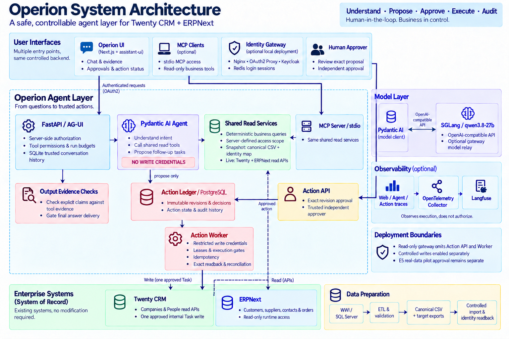

# Operion

English | [中文](README.zh-CN.md)

Operion is a controlled business agent layer built on top of Twenty CRM and
ERPNext. Agent and MCP workflows are the product focus; the business systems and a
lightweight ETL pipeline provide governed facts and tools.

The goal is to keep material business judgment with people while agents help with
search, consolidation, recommendations, and narrowly controlled execution.

## Demo video

[](https://www.youtube.com/watch?v=TxG6GOX3BZE)

[Watch **Operion** on YouTube](https://www.youtube.com/watch?v=TxG6GOX3BZE).

## Architecture



Architecture reviewed against the current implementation. This is a
component map; optional services are enabled separately, and the diagram does
not imply E5 production or real-data pilot approval.

The diagram separates browser access, Agent/MCP reads, controlled actions, and
data/telemetry flows. Repeated endpoint names refer to the same component;
arrows show requests or operations, rather than response data. Components inside
the Agent service boundary run within that service.

- **Web and identity:** Next.js / assistant-ui provides conversations, evidence,
  approvals, and action status. Server routes proxy AG-UI/SSE and action requests.
  The optional local HTTPS gateway uses Nginx, OAuth2 Proxy, Keycloak, and Redis
  login sessions; enterprise services enforce OIDC identity and server-side scope.
- **Agent and evidence:** FastAPI hosts the Pydantic AI runtime, calling local
  SGLang through an OpenAI-compatible API. SQLite holds trusted conversation
  history. Tool permissions, run budgets, and output checks against tool evidence
  constrain execution and final answers; these checks do not prove arbitrary
  natural-language claims.
- **Shared read services:** the Agent calls Python business tools directly;
  the separate stdio MCP server exposes the same repository services to MCP
  clients. Snapshot mode reads canonical CSV and an identity map; live mode
  queries Twenty and ERPNext with read-only credentials. Authorization scope and
  source provenance apply to both modes; frozen fulfilment cases are snapshot-only.
- **Controlled actions:** when separately enabled, the Agent records a follow-up
  proposal in the PostgreSQL action ledger. A human uses the Web and Action API
  to approve the immutable revision. The Worker enforces execution gates, leases,
  idempotency, readback, and reconciliation for the limited Twenty internal Task
  path. The read-only gateway stack deploys no Action API or Worker.
- **Data and operations:** WWI / SQL Server extraction produces validated
  canonical records and target exports; controlled imports and identity readback
  connect them to business systems. Optional OpenTelemetry traces flow through
  a Collector to Langfuse; telemetry does not authorize actions.

The image was generated with GPT Image using the built-in image-generation tool;
the [generation prompt](docs/imgs/architecture.prompt.txt) is retained
for future updates. Operational details: [Agent](ops/e2-agent.md),
[actions](ops/e3-action-control.md), [gateway](ops/auth-gateway.md), and
[telemetry](docs/enterprise/opentelemetry-langfuse-runbook.md).

## Current status

E0 through E4 have passed. The
project currently includes:

- a reproducible Wide World Importers download and minimal ETL pipeline;
- canonical records and target mappings for Twenty and ERPNext;
- pre-import validation for the generated files;
- Twenty REST readback for 10 WWI Companies and 25 People, including the 18
  expected Company relations;
- an ERPNext API audit covering 8 Customers, 2 Suppliers, 9 Items, 25 Contacts,
  8 Sales Orders, and 2 Purchase Orders;
- a GET-only cross-system identity reconciliation with 72/72 ERPNext and 35/35
  Twenty target identities matched;
- deterministic customer, supplier, contact-search, sales-order, purchase-order,
  portfolio, and fulfilment services exposed as fifteen snapshot-mode read-only MCP tools (fourteen in live mode, where frozen fulfilment cases are unavailable);
- a Pydantic AI / local SGLang read-only Agent with trusted server-side history,
  an AG-UI FastAPI endpoint, and an assistant-ui evidence desk;
- a PostgreSQL-backed action control service with immutable revisions and
  decisions, trusted approval, leases, reconciliation, and an idempotent E3
  fault-injection stub;
- approval and action-status pages backed by the server-side action ledger; and
- one separately approved Twenty internal follow-up Task path with deterministic
  IDs, exact readback, and recovery after response loss or worker crashes.

The E2 baseline passes all 15 behavior cases three times and all seven model
compatibility probes. E3 passes W01-W15 against a persistent stub, and E4
repeats the applicable gates against Twenty 2.39.0. Writes remain limited to one
internal Task in the isolated public/simulated demo workspace; E5 enterprise
identity, real-data controls, monitoring, and release operations are not yet
approved.
The next operational gate is an E5 single-operator, read-only pilot. The immediate
implementation priority is live cross-system correctness and final-answer
evaluation, followed by the first complete WWI import batch and measured
expansion. See the [prioritized improvement plan](docs/enterprise/improvement-plan.md)
(Chinese) for findings, dependencies, and acceptance criteria. Historical E0–E4
passes remain limited to their tested scope. The pilot does not authorize
real-data writes, which still require an independent approver and a separate gate.

A local HTTPS login gateway is now available with Keycloak, OAuth2 Proxy,
server-side Redis sessions, and private Web/Agent services. See the
[gateway runbook](ops/auth-gateway.md) and [acceptance scope](docs/enterprise/gateway-acceptance.md).
It uses synthetic users and public snapshots; browser and real-user pilot
acceptance remain separate.

The interview demonstration adds scoped customer/supplier search and order
listing/detail. It includes both a separate simulated dataset and a pinned,
deterministically extracted WWI public-sample dataset at the same demonstration
scale, while retaining the deterministic fulfilment check and its 15 fixed
evaluation cases. The first agent-initiated
write is deliberately limited to creating one internal follow-up task after an
exact preview and human approval.

Delivery sequence:

```text
use cases and expected answers
  → small linked dataset
  → read-only adapters
  → business tools and MCP
  → agent and evaluations
  → one controlled write
  → synchronization when justified
```

## Repository layout

```text
operion/
├── apps/web/                 # Next.js evidence desk, API proxies, approvals, actions
├── src/operion_etl/           # Agent, MCP, read services, action control, and ETL
│   └── migrations/           # PostgreSQL action-ledger schema and roles
├── deploy/                   # Optional auth gateway and OTel Collector configuration
├── scripts/                  # Setup, verification, demo, and acceptance entry points
├── tests/                    # Offline, authorization, Agent, and action-control tests
├── contracts/                # Canonical data, tools, actions, and enterprise boundaries
├── mappings/                 # Source-to-target mappings and fixed assumptions
├── docs/                     # Product, safety, evaluation, and operating plans
├── ops/                      # Runbooks for data preparation and recovery
├── evaluations/              # Evaluation definitions and fixtures
├── data/                     # Local source snapshots and generated exports
├── reports/                  # Local validation and reconciliation evidence
└── .github/workflows/        # Automated verification
```

Business data and generated reports are excluded from version control by default.

Within `src/operion_etl`, `agent_app.py` / `agent_runtime.py` implement the Agent,
`read_tools.py` / `mcp_server.py` implement the shared query layer,
`output_guardrails.py` / `answer_claims.py` / `business_facts.py` check answer
evidence, and `session_store.py` stores conversations. `action_app.py`,
`action_store.py`, `action_worker.py`, and `twenty_actions.py` implement the
separate action lifecycle. `pipeline.py`, pre-import validators, and readback
modules implement data preparation and reconciliation.

## ETL quick start

Requirements: Python 3.11+, Docker, and the source/target systems described in the
[runbook](ops/data-pipeline.md).

```bash
PYTHONPATH=src python3 -m operion_etl download-wwi
scripts/restore_wwi.sh data/raw/wwi/<snapshot>/WideWorldImporters-Full.bak
PYTHONPATH=src python3 -m operion_etl run \
  --snapshot data/raw/wwi/<snapshot> \
  --batch-id <unique-batch-id>
```

Run the reproducible verification entry point with the checked-in uv and npm lockfiles:

- scripts/verify.sh setup: install locked Python and Web dependencies.
- scripts/verify.sh offline: Python lint and offline tests.
- scripts/verify.sh web: Web type check and production build.

Offline tests use public sample inputs in tests/fixtures and need no restored WWI database. PostgreSQL action tests are a separate destructive group: run `scripts/verify.sh postgres` with Docker available. The runner creates and cleans up its own isolated container and ignores inherited database URLs. Direct destructive tests without runner ownership are rejected; skipped integration tests fail the runner. Use `scripts/verify.sh case` for JSON/JUnit/HTML developer evidence and per-case reruns. CI runs both groups and the Web build. The Web check uses Next.js webpack mode.

Run the deterministic test suite with:

```bash
PYTHONPATH=src python3 -m unittest discover -s tests -v
```

See the [runbook](ops/data-pipeline.md) for pre-import validation, Twenty loading,
ERPNext import prerequisites, and post-import reconciliation.
